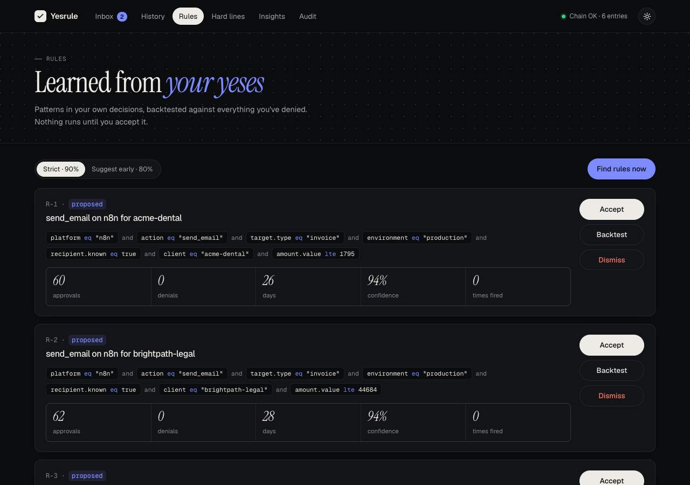
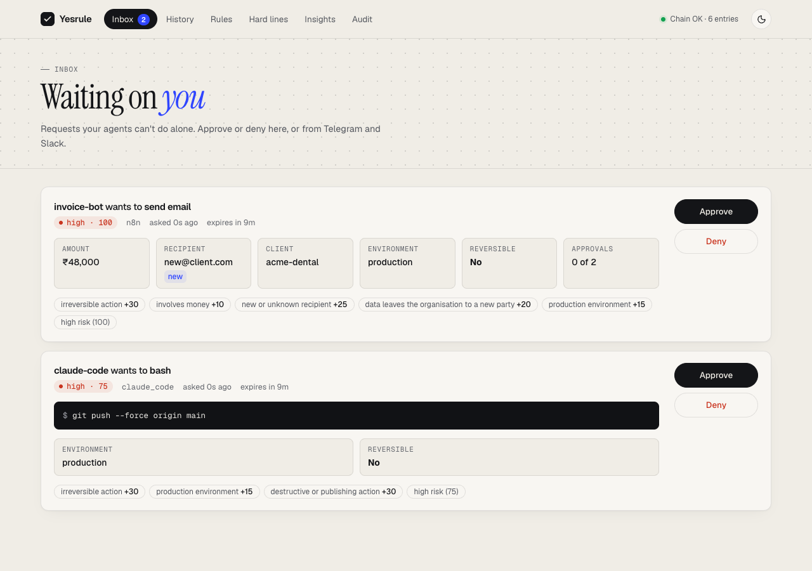
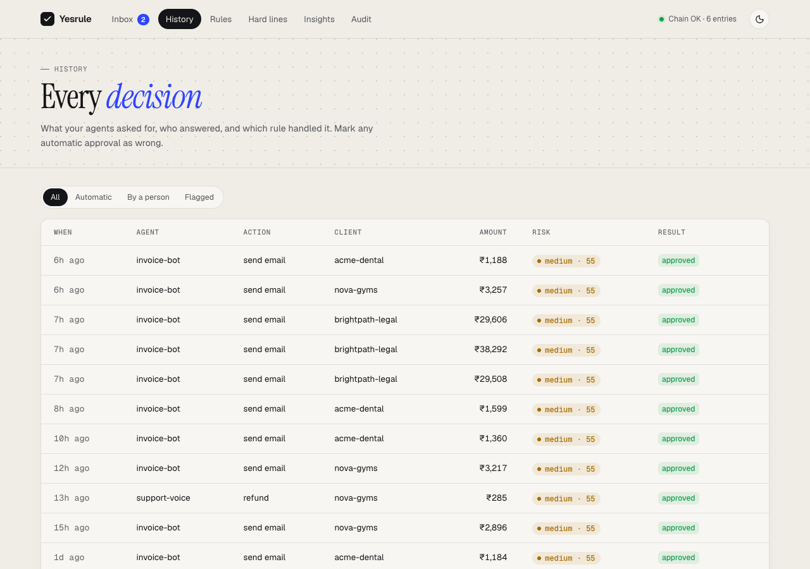
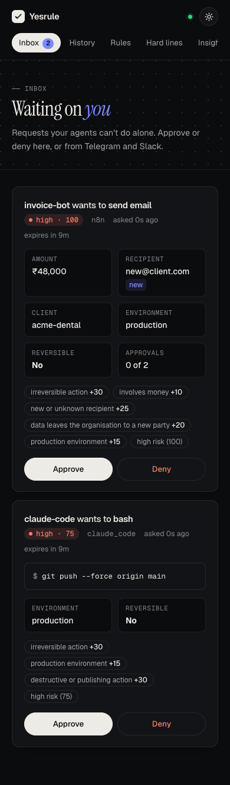

<p align="center"></p>

<p align="center">
<b>An approval layer for AI agents that learns rules from your own decisions.</b><br>
   
</p>

Your agents (Claude Code, n8n workflows, MCP clients, voice agents, your own Python code) ask before doing anything risky. You answer from Telegram, Slack or the web inbox. After you've said yes to the same kind of thing enough times, Yesrule **proposes a rule**, backtests it against everything you've ever denied, and, once you accept it, approves those requests for you **with a receipt** showing why.

<p align="center"></p>

## How it works, in one story

1. **Your agent wants to act.** An n8n workflow is about to email a €1,200 invoice to `billing@acme-dental.com`. Instead of sending, it calls Yesrule (`POST /v1/requests`).
2. **Yesrule scores the risk** with plain reasons: amount, new vs known recipient, irreversible, production. No LLM in this path, so the same input always gets the same answer.
3. **It checks your rules in a fixed order.** Hard lines and high risk always go to a person; no learned rule can override them.
4. **No rule matches yet, so it asks you.** Your phone buzzes on Telegram or Slack with Approve and Deny buttons, and the request also appears in the web inbox. Secrets are redacted before anything leaves the server.
5. **You tap Approve.** The workflow continues down its *Approved* branch. Your decision is written to a hash-chained audit log.
6. **After a few weeks of the same yes,** the miner notices 61 approvals, 0 denials over 25 days. It proposes *"send_email on n8n for acme-dental, amount ≤ 1,795"* and backtests it against every past denial.
7. **You press Accept.** From now on those invoices go through on their own, each with a receipt: *approved by R-1, based on 61 of your approvals, accepted by you on …*
8. **If it ever gets one wrong,** click *Wrong* on the receipt. The rule pauses immediately and your correction counts as a denial.

The result: you stop answering the same question 60 times, and you never hand over the risky ones.

| Inbox | History with receipts | Phone |
|---|---|---|
|  |  |  |

```
agent ──► Yesrule ──► risk score + reasons ──► hard line?  → ask a person
                                          ├──► deny rule?  → auto-deny
                                          ├──► high risk?  → ask a person (no rule can override)
                                          ├──► approve rule (accepted by you)? → auto-approve + receipt
                                          └──► otherwise   → ask a person (Telegram / Slack / web)
                         every step ──► tamper-evident hash-chained audit log
```

## Why it's different

| | Yesrule | Typical HITL tools |
|---|---|---|
| Learns rules from your decisions | ✅ Wilson-bound confidence, backtested, never auto-applied | ❌ you write every rule by hand, or approve forever |
| Receipt on every automatic approval | ✅ rule, evidence, who accepted it | ❌ |
| High risk can never be auto-approved | ✅ enforced in the decision order and tested on 1,000,000 random cases | varies |
| Works across tools | Claude Code hook, n8n node, MCP server, Python SDK, REST | usually one platform |
| Tamper-evident audit log | ✅ SHA-256 chain, `yesrule audit verify` | rarely |
| Self-hosted, no LLM in the decision path | ✅ decisions are deterministic | often SaaS |

## Quick start

```bash
cd engine && uv sync
uv run yesrule demo          # 30 days of realistic agency data
uv run yesrule mine          # → 3 proposed rules with evidence
uv run yesrule serve         # dashboard + API on http://localhost:8787
```

Or `docker compose up`.

### Claude Code
```bash
uv run yesrule install claude-code --dry-run   # shows exactly what changes in ~/.claude/settings.json
uv run yesrule install claude-code             # backs up your settings, adds PreToolUse/PostToolUse hooks
uv run yesrule install claude-code --remove    # removes only Yesrule's hooks
```
- Low-risk calls still use Claude Code's normal prompt, and your answer there becomes training data.
- Risky calls (`npm publish`, `git push --force`, `rm -rf`, edits to `.env`) are sent to your phone.
- **If the engine is down or nobody answers, it falls back to the normal prompt. It never silently allows.**

### n8n
`integrations/n8n-nodes-yesrule`: a **Yesrule Approval** node with **Approved** and **Denied** outputs.

### MCP (Claude Desktop, Cursor, Codex, any MCP client)
```json
{ "mcpServers": { "yesrule": { "command": "uv", "args": ["--directory", "/path/to/yesrule/engine", "run", "yesrule", "mcp"] } } }
```
Tools: `request_approval`, `check_approval`, `list_pending`, `explain_rules`.

### Python
```python
from yesrule.sdk import Yesrule
yr = Yesrule(agent="billing-bot")

@yr.guard(action="refund", amount=lambda order_id, value: value, reversible=False)
def refund(order_id: str, value: float): ...
```

### Bring your history
`yesrule import decisions.json` accepts a simple JSON list or an **n8n executions export** (Send-and-Wait approval nodes), so rule learning starts from your past decisions instead of from zero.

## How rule learning works

1. Group your human decisions by *action shape* (platform, action, target, known recipient, environment, client).
2. A group qualifies only with **≥10 approvals, zero denials, spread over ≥2 days**.
3. Confidence is the **95% Wilson lower bound** of the approval rate, and must be at least 0.90 (35 clean approvals). "Suggest early" mode lowers the bar to 0.80.
4. The rule is the **tightest** fit: amount ≤ the largest amount you actually approved.
5. It's **backtested** against all history: if it would have approved anything you denied, it's dropped.
6. It's created as `proposed`. Nothing changes until you press **Accept**.
7. **Drift watch:** mark an automatic approval as "Wrong" and the rule is paused, with your correction counted as a denial.

## Features

- Risk scoring with plain reasons
- Hard lines that always go to a person
- Two-person approvals (`approvals_needed`)
- Expiry
- Secret redaction before anything goes to chat
- Signed Slack requests (HMAC with replay protection) and a Telegram secret token
- Insights: automation rate, response time, time saved
- Monthly per-client reports for agencies
- Dashboard: Inbox, History, Rules, Hard lines, Insights, Audit

## Testing

| Suite | What it checks |
|---|---|
| `engine/tests` (61 tests) | unit, API and end-to-end loops: learning, the Telegram and Slack webhooks, the hook, the installer, MCP and the importer |
| `engine/stress/fuzz.py` | **500,000 randomised cases** per run, checked against safety invariants (below) |
| `integrations/n8n-nodes-yesrule` | type-checks against real `n8n-workflow` types, plus logic tests |

Invariants checked by `stress/fuzz.py`:
- high risk is never auto-approved
- a crossed hard line always asks a person
- inactive rules never change a verdict
- a learned rule never matches a past denial
- the amount bound is never wider than what was approved
- risk is always the capped sum of its reasons
- every edit, deletion, reorder or forged hash in the audit log is detected
- secrets never survive redaction
- the first final decision always wins through the real database

```bash
uv run python stress/fuzz.py --cases 500000 --seed 1
```

Results: seed 1 and seed 2 each ran **500,000 cases with 0 failures**.

The harness was itself verified by **planting bugs** in a scratch copy of the engine. Every planted bug was caught.

## Layout
```
engine/                     Python 3.13 · FastAPI · SQLAlchemy · Pydantic
  src/yesrule/core/         pure decision logic (risk, rules, miner, audit, redact)
  src/yesrule/adapters/     Claude Code hook, MCP server
  src/yesrule/web/          dashboard (served by the engine)
  stress/fuzz.py            500k-case property test
integrations/n8n-nodes-yesrule/   n8n community node (TypeScript)
docs/OVERVIEW.md · docs/BUILD_LOG.md
```

MIT licensed.
